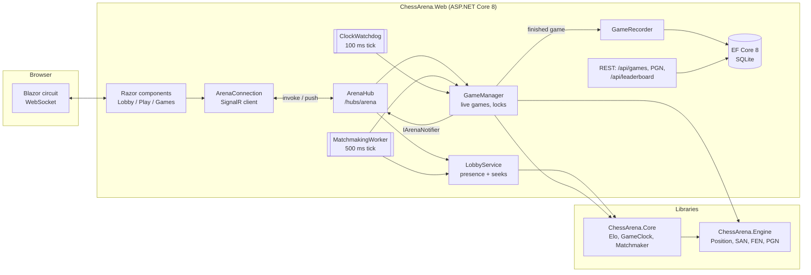

# ChessArena

**Real-time online chess on Blazor Server and SignalR, backed by a perft-verified rules engine.**

[](https://github.com/alexgeorghiou/chess-arena-blazor/actions/workflows/ci.yml)
[](LICENSE)


Pick a handle, press a time control and get paired with someone near your rating. Moves, clocks,
draw offers and spectator counts are pushed live over SignalR; finished games are rated with Elo,
stored in SQLite and can be downloaded as PGN.

## Features

- **Complete rules engine** in a dependency-free class library: legal move generation with
  castling, en passant and promotion; check, checkmate and stalemate; threefold repetition
  (Zobrist keys that respect castling rights and *usable* en passant squares), the fifty-move rule
  and insufficient material.
- **Perft-verified**: node counts for the start position (depth 1-5), Kiwipete (1-4) and three more
  standard positions match the published reference values.
- **Notation**: FEN parse/serialize with validation, SAN with minimal disambiguation and check/mate
  suffixes, PGN export (Seven Tag Roster, `SetUp`/`FEN`, 80-column wrapping) and a PGN reader that
  replays the mainline through the engine.
- **Matchmaking by Elo** with a rating window that widens the longer a seek waits. Pairing needs
  mutual acceptance, so a newcomer is never forced onto a lopsided game just because the other
  player has waited a long time.
- **Fischer clocks** with increment; flags fall from a server-side watchdog. Losing on time against
  a lone king or a single minor piece is a draw, as in FIDE Laws.
- **Elo ratings** with FIDE-style K-factors (40 provisional, 20 standard, 10 for 2400+), applied
  together with the archived game in a single transaction.
- **Spectators**: anyone can open a live game; viewers are counted per connection.
- **Lobby**: open seeks, live games, online count and a leaderboard, refreshed in real time.

## Architecture



A move travels like this: the board component emits a UCI string, `ArenaConnection` invokes
`ArenaHub.MakeMove`, and `GameManager` validates it under the game's lock (turn, legality, then
the clock), applies it, and broadcasts the new `GameStateDto` to the game's SignalR group. When a
game ends, the archive applies Elo and stores moves, clock times and PGN before the final state,
including rating deltas, goes out.

## Quickstart

Prerequisite: the [.NET 8 SDK](https://dotnet.microsoft.com/download/dotnet/8.0).

```bash
dotnet run --project src/ChessArena.Web
# open http://localhost:5080 in two browsers (or a normal and a private window),
# pick two handles and press the same time control in both
```

The SQLite database (`chess-arena.db`) is created on first start.

With Docker:

```bash
docker compose up --build
# http://localhost:8080 - data persists in the arena-data volume
```

Tests:

```bash
dotnet test                                   # everything, including deep perft
dotnet test --filter "Category!=Slow"         # skip start-position depth 5 and Kiwipete depth 4
```

### Configuration

| Key | Default | Meaning |
| --- | --- | --- |
| `ConnectionStrings:Arena` | `Data Source=chess-arena.db` | SQLite database |
| `Arena:Matchmaking:InitialWindow` | `50` | Rating gap accepted immediately |
| `Arena:Matchmaking:WindowGrowthPerSecond` | `15` | Growth of the gap per second of waiting |
| `Arena:Matchmaking:MaxWindow` | `600` | Upper bound on the gap |
| `Arena:HubBaseUrl` | browser base URI | Address server-side components use to reach the hub |

## Project structure

```
src/
  ChessArena.Engine/      Pure rules engine: Position (make/unmake, attacks, move generation),
                          Fen, San, Pgn, Perft, ChessGame (results and draw rules)
  ChessArena.Core/        Elo, TimeControl + GameClock (TimeProvider-based), Matchmaker
  ChessArena.Web/
    Components/           Board (ChessBoard, ChessClock, MoveList, PlayerStrip), pages, layout
    Hubs/                 ArenaHub, typed client contract, DTOs, SignalR notifier
    Live/                 LiveGame, GameManager, LobbyService, background workers
    Data/                 ArenaDbContext, PlayerStore, GameArchive
    Services/             ArenaConnection (hub client), PlayerSession
    Api/                  Minimal API endpoints (game list, PGN, leaderboard, health)
tests/
  ChessArena.Engine.Tests/  Perft, FEN, SAN, game rules, PGN
  ChessArena.Core.Tests/    Elo, time controls, clocks, matchmaking
  ChessArena.Web.Tests/     bUnit components, GameManager, persistence, hub end-to-end
```

## Design decisions and trade-offs

- **Engine without dependencies or bitboards.** A 64-square mailbox with precomputed leaper tables
  and rays is easy to read and fast enough here (the whole perft suite, depth-5 start position included, runs in seconds). Legal moves
  come from pseudo-legal generation followed by make/test/unmake. This is the simplest approach that
  is clearly correct, and perft is what proves it.
- **Moves carry no flags.** `Move` is just from/to/promotion; castling, en passant and double pushes
  are inferred from the position. That means UCI strings from the UI map straight onto moves, and the
  server never has to trust anything the client says about a move.
- **The server is the only judge.** The board component only offers moves from the server's legal
  move list. It has no chess logic of its own, so client and server cannot disagree.
- **Claimable draws are automatic.** Threefold repetition and the fifty-move rule end the game
  immediately, as most online servers do, rather than waiting for a claim.
- **Passive clocks.** `GameClock` has no timers. It does arithmetic over an injected `TimeProvider`,
  and a single watchdog loop polls it. That makes it deterministic under `FakeTimeProvider` and avoids
  one timer per game. The clock is checked before the move is applied, so a legal move sent after the
  flag fell still loses on time.
- **Matchmaking on a tick.** Running the matcher every 500 ms instead of on each seek is what lets
  windows widen with time. It also keeps pairing single-threaded and lets one pass pair many players.
- **Components use a real SignalR client.** The Blazor Server circuit connects to its own hub over a
  `HubConnection`. That costs a loopback connection per circuit. In return, the UI goes through the
  same protocol, groups and validation as any external client, and the end-to-end test drives exactly
  that path.
- **Handle-based identity.** Players pick a handle and the id is kept in protected browser storage.
  There are no passwords, which keeps the demo frictionless but means anyone who knows a player id
  can act as that player. Real deployments need authentication (see roadmap).
- **`EnsureCreated` instead of migrations.** The schema is created on first start, which keeps the
  repository free of generated migration code while the model is still changing. Moving to EF
  migrations comes before any schema change to a live database.
- **Single node.** Live games are kept in memory in one process. Scaling out would need a SignalR
  backplane and either sticky game ownership or an external store for live state.

## Roadmap

- ASP.NET Core Identity or OAuth sign-in; bind hub calls to the authenticated user
- First-move grace period and abandonment detection for disconnected players
- Rematch offers, takebacks and challenge links for friends
- Game replay viewer for archived games (the moves and FENs are already stored)
- Glicko-2 ratings per time-control category
- EF Core migrations and a Postgres option
- Redis backplane for multi-instance deployments

## License

[MIT](LICENSE) - Copyright (c) 2026 Alex Georghiou
